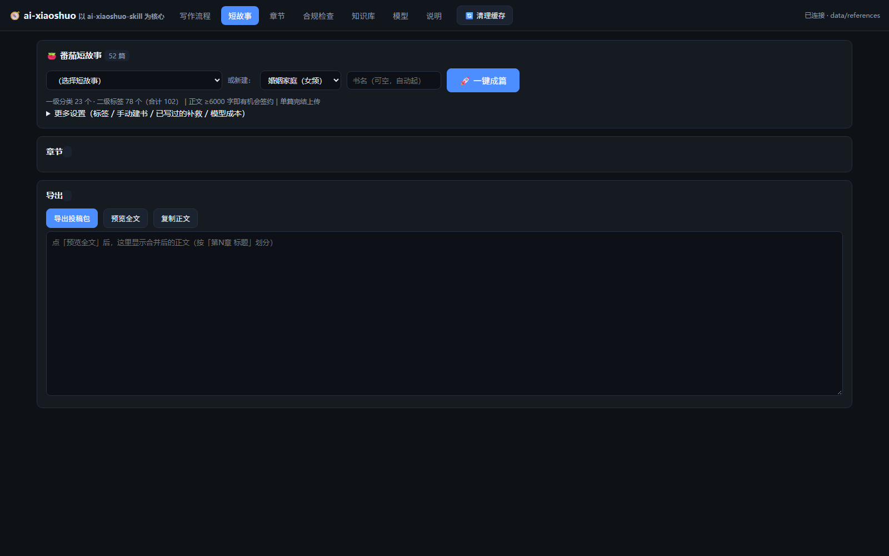
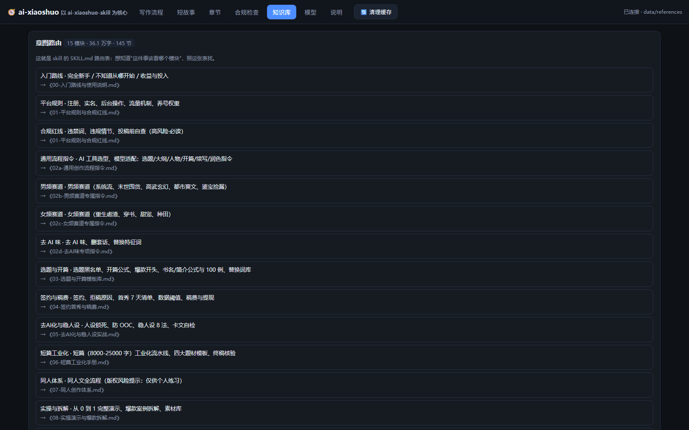
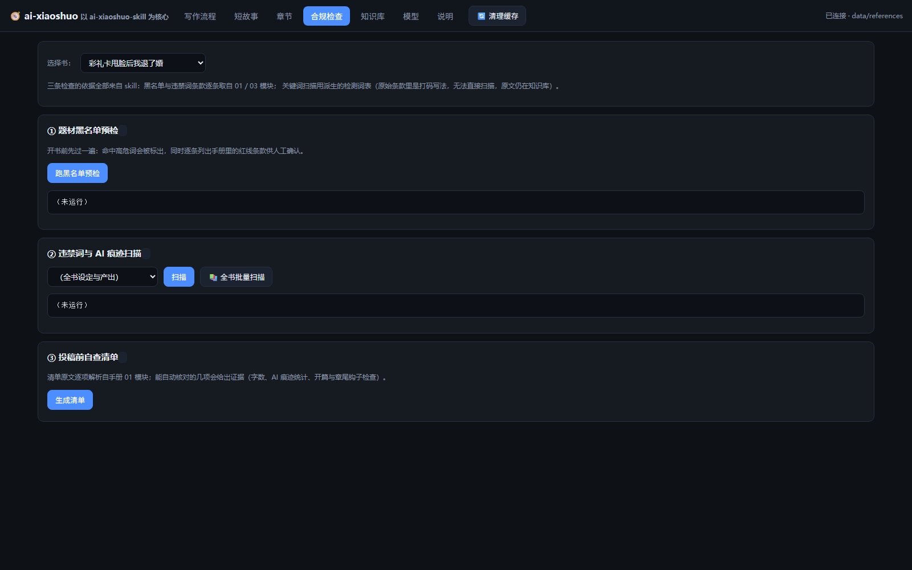

# ai-xiaoshuo · 番茄小说 AI 写作平台

[](https://github.com/linghan666666/ai-xiaoshuo/actions/workflows/ci.yml)
[](LICENSE)
[](https://www.python.org/)

自托管的网文写作工具。**手册（skill）就是平台本身**：
手册的工作流 → 平台的流程，手册的原文指令 → 平台的提示词，手册的清单 → 平台的检查项。

内置 15 个模块（约 37 万字）。模型走任意 OpenAI 兼容网关，也可以用「网页版人工通道」零 API 运行。

| 短故事 · 一键成篇 | 知识库 | 合规检查 |
|---|---|---|
|  |  |  |

---

## 能做什么

**写短故事（番茄短故事口径）**

选一个分类 → 点「一键成篇」，自动跑完：

```
构思开篇冲突 → 建书 → 起书名（含联网查重）→ 三份设定表 → 五章大纲
→ 一次成稿 → 逐章去 AI 味 → 全书违禁词扫描 → 导出投稿包
```

- 102 个作品分类标签（24 个一级 + 78 个二级，与官方发布页一致）；
- 选中「追妻火葬场」这类标签，会强制按对应的情节链路写（前 3 章伤害离开、后 2 章追悔付出代价）；
- 带步骤进度条与超时告警；中断后可从断点续跑。

**写长篇 / 中篇**

- 长篇 9 步、完本中篇 10 步（含完本三审预检）、短篇工业化 8 步、卡文急救工具箱；
- 每章自动产出结构化摘要与伏笔台账，起草下一章时自动注入前情（默认最近 6 章）；
- 改写保护：字数骤降/暴涨、输出不像正文时会拒绝覆盖，结果留在生成记录里可手动采用或回滚。

**检查与合规**

- 违禁词与 AI 痕迹扫描（可全书批量）；
- 人设校验（角色是否缺席、人名是否漂移）；
- 大纲偏离检测；投稿前自查清单（能自动核对的给证据）。

---

## 快速开始

```bash
pip install -r requirements.txt
python -m uvicorn app.main:app --host 127.0.0.1 --port 8788
# 打开 http://127.0.0.1:8788
```

Windows 也可以双击 `启动写作平台.bat`（自动挑端口、4 秒后打开浏览器）。

首次使用到「模型」页添加一个模型（OpenAI 兼容接口 + 密钥，点「测试」确认连通）。
没有 API 也能用：选「网页版人工通道」，平台给你提示词，你去网页 AI 执行后把结果贴回来。

不花钱的自测：

```bash
python tools/dev/smoke_test.py --inproc   # 假模型，跑完整链路
```

---

## 为什么「以 skill 为核心」

常见做法是先造一台通用节点引擎，再把手册当参考资料挂上去——手册的价值靠「人记得去查」，
平台的提示词、检查项、流程与手册是两套东西，会各自漂移。

这里反过来：**手册是引擎**。

| skill 里的东西 | 平台里的形态 |
|---|---|
| 工作流 A/B/C | **流程**（长篇 9 步 / 中篇 10 步 / 短篇 8 步 / 短故事 8 步 / 卡文急救） |
| 可直接复制给 AI 的原文指令 | **提示词**：每步按「模块 + 关键词」抽取原文节，连同出处注入 |
| 违禁词清单 / 自查表 / 题材黑名单 | **检查**：黑名单预检、违禁词扫描、投稿前自查 |
| 15 个模块（约 37 万字） | **知识库**：内置，可浏览、检索、按模块抽指令块 |

每个流程步骤由四要素定义（`app/flows/definitions.py`）：
`modules`（去哪些模块取指令）· `keywords`（怎么挑原文节）· `inputs`（带哪些前序产出）· `check`（配套哪条检查）。

> 边界说明：随 skill 自动变的是**指令原文 / 检查条款 / 可查内容**；
> 流程的步骤结构写在 `definitions.py` 里，新增工作流需要在那里加定义。

---

## 目录结构

```
app/
├── config.py            路径 / 知识库目录 / 意图路由表 / 限额
├── store.py             SQLite（models / books / artifacts / chapters / gens / checks）
├── textkit.py           字数与文本处理（全平台唯一口径）
├── knowledge/           skill 知识库层
│   ├── library.py         模块 → 节索引 / 全文 / 检索
│   ├── blocks.py          指令块抽取（按模块+关键词抽原文）
│   ├── assets.py          清单资产（黑名单 / 违禁词 / 自查表）
│   └── data/              内置 skill 副本（15 模块 + SKILL.md）
├── flows/               流程层
│   ├── definitions.py     各流程的步骤定义
│   └── runner.py          提示词组装 + 后台生成 + 落库留痕
├── llm/client.py        模型接入（流式 / 关思考 / 跳过代理 / 网页通道）
├── checks/checks.py     违禁词 / AI 痕迹 / 人设 / 偏离检查
├── api/                 6 个路由（books / chapters / checks / kb / models / short）
├── short_categories.py  短故事 24 个一级分类
├── short_tags.py        短故事 78 个二级标签
└── main.py              入口

static/                  前端（原生 JS，无构建步骤）
tools/dev/               假模型 + 端到端自测 + 并发/后台探针
docs/                    设计说明（DESIGN.md）与界面截图
```

---

## 配置

复制 `.env.example` 为 `.env` 可改端口、数据库位置、知识库目录；不配也能跑。

- **想让平台直接引用你本机更新后的 skill**：把 `PLATFORM_SKILL_DIR` 指向它的 `references` 目录（默认用内置副本）。
- **数据都在 `data/`**：数据库（含模型密钥）、导出包、备份。这个目录已在 `.gitignore` 中，不会进版本库。
- **备份**：复制整个 `data/` 文件夹，换机器拷过去即可。

---

## 已知限制

- 一次让模型写完五章时，后段章节可能偏短。平台会校验，不达标自动降级为逐章生成；改写时字数异常会拒绝覆盖正文。
- 不内置 AI 生图，封面需外部工具（即梦 / Canva 等）生成。
- 完整端到端自测在本地跑最稳；CI 只做语法与结构自检（不依赖模型）。

---

## 免责声明

- 个人创作辅助工具，不隶属于番茄小说 / 字节跳动，未获其授权或背书。
- `app/knowledge/data/` 内的知识库为学习笔记性质的二次整理，素材来自公开发布的写作课程与平台公开规则；
  如权利人认为不妥，请提 Issue，会及时移除相关段落。
- **纯 AI 稿件不能直接投稿**：请人工打磨、核对违禁词与平台最新规则。生成内容与发布后果由使用者自负。
- 签约、稿费、审核的结论以番茄官方最新公示为准。

## License

代码以 [MIT](LICENSE) 开源。知识库内容（`app/knowledge/data/`）不随 MIT 授权，仅限个人学习使用。
